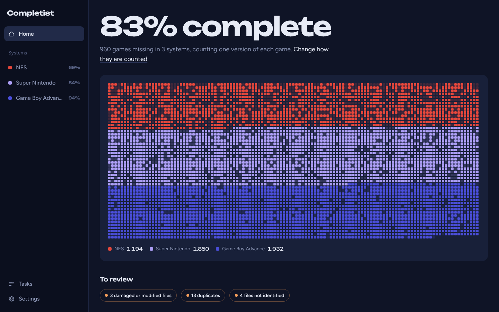
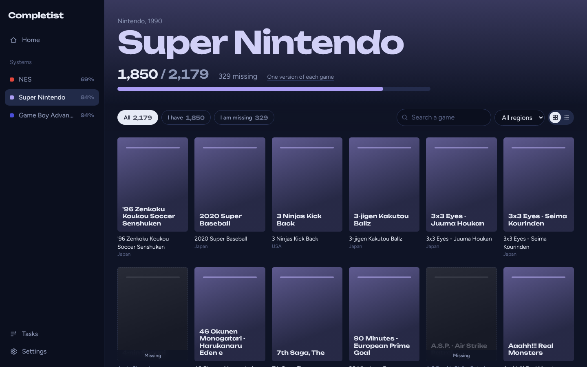
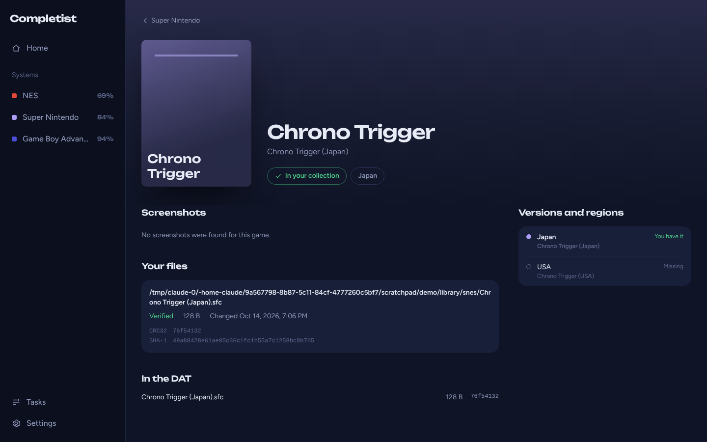

# Completist

**The ROM library manager that tells you what's missing.**

Completist compares your ROMs with the No-Intro and Redump DATs and shows, system by system, what you have,
what is missing and which files are damaged, duplicated or unknown. It runs on your NAS, your
Unraid server or your computer, as one small program with its database inside.

[Español](README.es.md)



> Completist is young: cartridge systems, DATs, the collection and its counts are there. Disc
> systems, compression and renaming come next (see the [roadmap](#roadmap)).

## What it does

- **Tells you what is missing.** Every system shows how many games you have, how many there are
  and which ones are missing, with the missing ones in place in the grid, greyed out.
- **Counts your way.** One version of each game (any region or revision counts), every official
  release, or the whole DAT with prototypes and homebrew. A default for all systems, and a choice
  for each one.
- **Finds games by their content, not their name.** Files are identified by their checksums, so a
  badly named file is still found. Copier headers (NES, SNES, Lynx, Atari 7800, PC Engine) and the
  byte orders of Nintendo 64 dumps are handled. Zip files are read too.
- **Shows what to review**: files with the name of a game but other content (bad dumps, hacks,
  damaged files), files not in the DAT, and duplicates.
- **Keeps the DATs up to date**: downloaded from libretro-database and updated every week, or
  imported from your own DAT files (Logiqx XML or clrmamepro).
- **Looks good**: box art, screenshots, a page for each game with its versions and regions, a
  dark or light interface that works on a phone, in English and Spanish. Each image is downloaded once and
  kept, so pages load at once, also without internet; box art can be kept as a JPEG of high
  quality, in a quarter of the space.
- **Stays up to date**: Completist notices when files are added, removed or replaced and scans
  again; network shares are checked every two minutes. Unchanged files are not read twice, so
  10,000 files are checked in under a second.
- **Statistics**: how complete the collection was day by day, by maker and by region, the
  systems closest to complete, the space each one takes and the games added lately.
- **A wishlist** of the games you are looking for, marked in the grid, with a notification when
  one reaches your collection.
- **Exports** to RetroArch playlists and ES-DE gamelists, with the DAT names, so their box art
  shows too.
- **Organizes your files**: renames them to the names of the DATs (the tracks of a disc and its
  CUE sheet too), packs cartridge dumps in zip files, turns BIN/CUE and ISO images of discs into
  CHD without chdman, and compresses PSP ISO files into CSO and GameCube and Wii ISO files into
  GCZ; each new file is read back and checked against the DAT before its original is removed. You
  see every change before it is made, and every change can be undone.
- **Shows where the space goes**: what each system takes by format, the space in duplicates and
  in files not in the DATs, and what could be compressed, with a link to do it.
- **A fixdat of what is missing** for each system, in the counting mode you chose, to look for
  those games with any ROM manager.
- **Tells you the news** through Discord, Telegram or any webhook: games new in your collection,
  sets you complete, damaged files found and new entries in the DATs.
- **Keeps a backup** of the libraries, DATs, settings and users every week, and keeps the last five;
  a backup can also be downloaded and restored from the settings.
- **Built for a server**: user accounts (administrator or read only), protection against password
  guessing, live tasks, a JSON API, read-only libraries and a Docker image for amd64 and arm64.

| | |
| --- | --- |
|  |  |

The screenshots were taken without access to the cover server, so they show the covers
Completist draws when a game has none.

## Systems

Cartridge systems with No-Intro DATs: NES, Famicom Disk System, Super Nintendo, Nintendo 64,
Virtual Boy, Game Boy, Game Boy Color, Game Boy Advance, Nintendo DS, Pokémon Mini, SG-1000,
Master System, Mega Drive, 32X, Game Gear, PC Engine, Atari 2600, Atari 7800, Lynx, Neo Geo Pocket
(and Color), WonderSwan (and Color), ColecoVision, Intellivision and Vectrex.

Disc systems with Redump DATs: PlayStation, PlayStation 2, PSP, Saturn, Mega CD, Dreamcast,
GameCube and Wii. Completist reads the usual formats itself, with no external tool:

| Format | Systems | How it is identified |
| --- | --- | --- |
| BIN with CUE or GDI | PlayStation, PS2, Saturn, Mega CD, Dreamcast | The data track the DAT lists, by its checksums |
| ISO | PS2, PSP, GameCube, Wii | By its checksums |
| CHD (CD, GD-ROM, DVD) | PlayStation, PS2, PSP, Saturn, Mega CD, Dreamcast | Read back as the original tracks or ISO |
| GCZ, CSO | GameCube, Wii, PSP | Read back as the original ISO |
| RVZ, WIA, WBFS | GameCube, Wii | By the game code in the disc header: these leave out data, so they cannot be checked |

A game on several discs counts once, when you have all of them.

What Completist writes when it compresses, all with no loss: CHD for the CD systems, PS2 and PSP
(read by RetroArch, DuckStation, PCSX2, PPSSPP, Flycast and others); CSO for PSP; GCZ for GameCube
and Wii, which Dolphin reads. It does not write RVZ: that needs a Zstandard encoder and, for Wii
discs, the console's keys to decrypt them, which Completist does not ship. Dolphin turns a GCZ
into RVZ in a few clicks if you want the smaller file; Completist still recognises it afterwards.

## Quick start

### Docker

```sh
docker run -d --name completist --restart unless-stopped \
  -p 3000:3000 \
  -e PUID=1000 -e PGID=1000 -e TZ=Europe/Madrid \
  -v /path/to/appdata:/data \
  -v /path/to/your/roms:/roms \
  delfus77/completist
```

Open http://localhost:3000. The folder mounted on `/roms` is added as a library on the first
start. Or use [docker-compose.yml](docker-compose.yml).

| Setting | Meaning |
| --- | --- |
| `/data` | The database and the settings |
| `/roms` | Your ROMs. Add `:ro` to mount it read only; then Completist cannot rename or pack them |
| `PUID`, `PGID` | The user and group that own your files (`id` on the host). The app never runs as root |
| `TZ` | Your time zone |

### Unraid

Install the template by hand until it is in Community Applications: in a terminal on the server

```sh
wget -O /boot/config/plugins/dockerMan/templates-user/my-completist.xml \
  https://raw.githubusercontent.com/DeLFuS77/completist/main/templates/completist.xml
```

then **Docker > Add Container** and pick `completist`. Set **ROMs** to your share.

### Windows, macOS and Linux

Build it (see [Building](#building)) and run `completist`. It keeps its data in a `data` folder
next to the program, or where `COMPLETIST_DATA_DIR` says. Open http://localhost:3000.

## First start

1. Add the folder with your ROMs in **Settings > Libraries**. Subfolders named after a system
   (`snes`, `Mega Drive`, `gba`...) tell Completist what each file is; otherwise the extension
   does. A file is found by its content anyway once its DAT is there.
2. Download the DATs of your systems: one click on the home page, or choose them in
   **Settings > DATs**.
3. Your collection appears, system by system.

## How games are counted

| Mode | Counts |
| --- | --- |
| One version of each game | Each game once, whatever its region or revision. Betas, demos, prototypes, unlicensed games, hacks and BIOS files are left out |
| Every official release | Each region and revision of the official games on its own |
| Every entry of the DAT | The whole set |

For one version of each game, versions are grouped by their title in the DAT, and the preferred
regions decide which one is shown when you have none.

## Users

Without users, anyone on your local network can use Completist, and it does not answer from
outside it. Create an administrator in **Settings > Users** to require a login, then add more
users, administrators or read only. Passwords are stored as PBKDF2 hashes; failed logins are slowed
down and then blocked.

`COMPLETIST_AUTH_USERNAME` and `COMPLETIST_AUTH_PASSWORD` set an administrator from the
environment, useful when a password was forgotten. Use HTTPS (a reverse proxy) when the app can
be reached from the internet.

## Settings in the environment

| Variable | Default | Meaning |
| --- | --- | --- |
| `COMPLETIST_DATA_DIR` | `data` next to the program, `/data` in Docker | The database and settings |
| `COMPLETIST_PORT` | `3000` | Port of the web interface |
| `COMPLETIST_LIBRARIES` | | Folders added as libraries on the first start, separated by commas |
| `COMPLETIST_WATCH` | `true` | Scan when files change; `false` turns it off |
| `COMPLETIST_WATCH_INTERVAL_MINUTES` | `2` | How often the folders are checked for changes, for network shares that do not report them |
| `COMPLETIST_SCAN_INTERVAL_MINUTES` | `360` | A full scan as a safety net; `0` turns it off |
| `COMPLETIST_AUTO_BACKUP` | `true` | A copy of the state every week; `false` turns it off |
| `COMPLETIST_ALLOWED_HOSTS` | | More host names the app answers to while no user exists |
| `COMPLETIST_DAT_UPDATE_HOURS` | `168` | How often the downloaded DATs are updated; `0` turns it off |
| `COMPLETIST_SCAN_WORKERS` | up to 4 | Files read at the same time |
| `COMPLETIST_DAT_URL` | the metadat folder of libretro-database | Where the DATs are downloaded from, for a mirror with its `no-intro` and `redump` folders |
| `COMPLETIST_COVERS_URL` | thumbnails.libretro.com | Where the images are downloaded from, for a mirror |
| `COMPLETIST_AUTH_USERNAME`, `COMPLETIST_AUTH_PASSWORD` | | An administrator |
| `COMPLETIST_ALLOW_REMOTE_WITHOUT_LOGIN` | | `true` when another service protects the app |
| `COMPLETIST_TRUSTED_PROXIES` | | `cloudflare`, or proxy addresses, for the real address of visitors |

## API

The interface uses a JSON API that scripts can use too, with HTTP basic authentication when a login
is required (a read-only user is enough to read).

| Endpoint | Description |
| --- | --- |
| `GET /api/overview` | The summary and the progress of every system |
| `GET /api/systems/{id}/games?filter=missing` | The games of a system: `have`, `missing` or all |
| `GET /api/games/{id}` | A game, its versions and your files |
| `GET /api/stats` | The statistics, with the history day by day |
| `GET /api/wishlist` | The wishlist; `PUT` or `DELETE /api/wishlist/{system}/{name}` changes it |
| `GET /api/export/retroarch?from=&to=`, `GET /api/export/esde` | The exports, as zip files |
| `GET /api/organize?system=snes&kind=rename\|zip\|chd\|cso\|gcz` | What renaming, packing or compressing would do; `POST` does it, `GET /api/organize/history` lists the changes and `POST /api/organize/history/{id}/undo` undoes one |
| `GET /api/systems/{id}/fixdat` | A Logiqx DAT of the games missing in a system |
| `GET /api/space` | The space each system takes, by format, with duplicates and what can be compressed |
| `GET /api/covers/{system}/{boxart\|snap\|title}/{name}.png` | An image of a game, by its name in the DAT |
| `POST /api/scan` | Scan the libraries |
| `POST /api/dats/sync` | Download the DATs |
| `GET /api/tasks/events` | Running tasks, as server-sent events |
| `GET /healthz` | Health check, without login |

## Roadmap

1. **Done**: the core, cartridge systems, DATs, counting modes, the new interface, covers kept by
   the server, statistics, a wishlist, exports to ES-DE and RetroArch, the disc systems, and
   renaming, zip, CHD, CSO and GCZ with undo, the Space page, fixdats and a light theme.
2. Next: ideas welcome in the issues.

## Building

Requirements: [Go](https://go.dev) 1.26 or newer and [Node.js](https://nodejs.org) 22 or newer.

```sh
git clone https://github.com/DeLFuS77/completist.git
cd completist
make ui      # the interface (Svelte, Tailwind, esbuild)
make build   # build/completist, with the interface inside
make test
```

`make dev` rebuilds the interface on every change and serves it without building Go again.

## License

[GNU AGPL 3.0](LICENSE). See [NOTICE](NOTICE.md) for the components and data it uses.
Completist contains no games and never downloads them: use it with backups of games you own.
